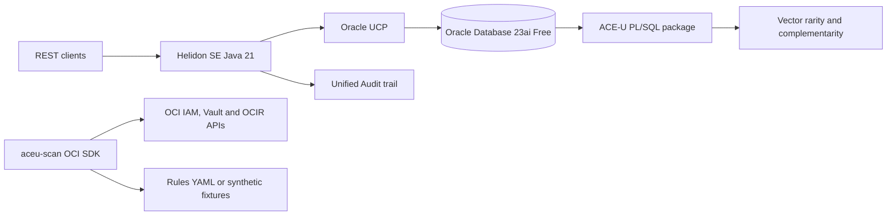

# OCI ACE-U Patterns

A synthetic-data-only Oracle portfolio: 16 runnable or manually verified examples from the Oracle ACE article series, an Oracle Database 23ai ACE-U scoring service, and a read-only OCI posture scanner. ACE-U is an inspectable conceptual framework, not a validated assessment of people. No real professional profiles are used or seeded.

## Architecture



## Quickstart

Requirements: Java 21, Maven, Docker Compose, Python 3.10+ for `aceu-scan`. Terraform is needed only for local format/validation of the OCI examples.

```sh
./scripts/demo.sh
```

The script builds the Java 21 image, starts `gvenzl/oracle-free:23-slim-faststart`, waits for the database/service, makes six REST calls, and prints the Unified Audit trail. It seeds three synthetic profiles. The service exposes `POST /profiles`, `GET /profiles/{id}/score`, `POST /rank`, `POST /contest`, and `GET /health`. Explicit consent is required for profile creation; scoring, ranking, and contesting exclude profiles without consent.

To stop the local stack and delete its synthetic database volume: `docker compose down -v`.

## What runs where

| Article folders | Runs where | Notes |
| --- | --- | --- |
| `java-oci/09-min-container`, `db-sec/10-authid`, `db-sec/12-unified-audit`, `java-oci/13-jdbc-tls`, `java-oci/14-ucp-tuning` | Local Oracle Free | 13 exercises plain TCP; TLS and wallet configuration are documented separately. 09 builds the flagship service image. |
| `oci-iam/01-instance-principals`, `oci-iam/02-least-privilege`, `oci-iam/03-dynamic-groups`, `oci-vault/06-secrets-basics`, `oci-vault/07-db-wallets`, `ocir/08-basics`, `oci-iam/16-compartments` | OCI, Terraform | Always Free eligible resources where available; networking, images, OCI limits, and regional availability are user supplied. CI runs format and validation only. |
| `identity-domains/04-federation`, `identity-domains/05-mfa`, `db-sec/11-tde`, `oci-ai/15-language-vision` | Manual verification | Console or account/feature dependent. No claim of execution. |
| `aceu-scan --fixtures` | Local, offline | Uses synthetic JSON fixtures; online mode is read-only and requires OCI CLI config. |

Each article folder includes a worked example transcribed from the matching enhanced article draft, plus run and cleanup steps. The article series landing page is [Oracle ACE writing](https://www.imshubh.com/blog.html#oracle-ace). Each README keeps a `TODO tested-on` line for the maintainer to fill after running that individual demo.

## ACE-U service

Java 21, Maven, Helidon SE 4.2.6, Oracle JDBC/UCP, and Oracle Database 23ai Free. The score package ports the Python reference formulas: A uses skill/role Jaccard overlap and authored-skill coverage; C weights verified and inferred evidence; E combines interaction quality, reciprocity, and type diversity; U combines vector-distance rarity and context complementarity, gated by `min(A,C,E)`. All four dimensions expose separate uncertainty and a human-readable explanation. Skill vectors use a deterministic, offline ten-skill vocabulary.

The shared PL/SQL engine uses `AUTHID CURRENT_USER`; the definer-rights compute wrapper is restricted with `ACCESSIBLE BY` to the service package. Score SELECTs are covered by the Unified Auditing policy in `aceu-trust-service/db/03-audit.sql`. The runtime uses a restricted `ACEU_APP` account with only required table operations and package execution. UCP defaults are min 2 / max 8, validation on borrow, 5 second wait, with live pool metrics logged by `/health`.

## OCI scanner

```sh
python -m venv .venv && . .venv/bin/activate
python -m pip install -e '.[dev]'
pytest
python aceu_scan.py --fixtures
# Live, read-only scan using the configured OCI CLI profile:
python aceu_scan.py
```

Rule definitions are in `rules/*.yaml`; adding checks against the listed OCI resource fields and supported predicates does not require editing Python. Live mode reads tenancy policies, dynamic groups, Vault secrets, and container repositories. Findings include the matching OCI documentation link.

## Terraform

`terraform/` contains modules for a child compartment, a defined-tag-scoped dynamic group, least-privilege secret-bundle access, Vault/key/secret, a private OCIR repository, and a VM.Standard.A1.Flex instance. Defaults are placeholders. Before applying, configure valid provider credentials, tenancy/region/network/image values, tag namespace use, and a synthetic short-lived OCIR credential in the sensitive secret variable; inspect the plan and replace defaults in a local ignored tfvars file. **CI never applies Terraform.**

## Verification

CI runs Maven unit and Oracle-container integration tests, the six-call compose demo, pytest per scanner rule, Terraform format, and Terraform validation. Local runs performed for this repository are recorded in the work session; each demo README retains a TODO tested-on line for your own future runs.
